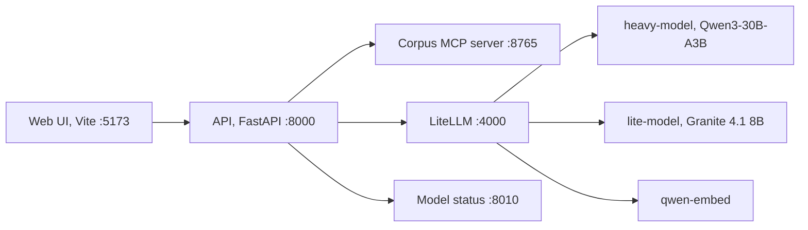
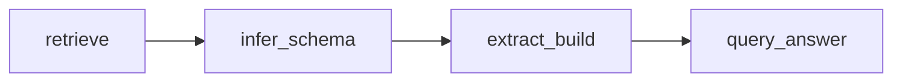
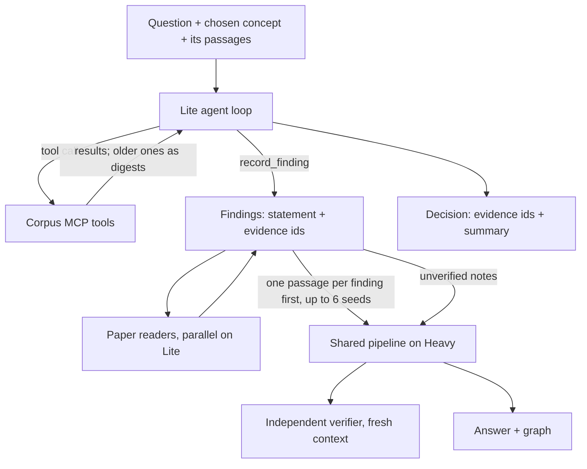

# Architecture

How a question becomes an answer, which model does what, and where each step lives. Vocabulary is defined in `CONTEXT.md`; decisions in `docs/adr/`.

## Services

LiteLLM, the models and the status API come from thesis-llm-setup. The API never calls raw vLLM ports.

## One run

Every path first turns the question into a typed plan (`planner.py`). Metadata and citation operations (authors, years, citing papers, author rankings) are answered from verified DBLP facts without full-text research; everything else is research. A fact plan must take its arguments (papers, venues, title term, year) from the question's own words, never from a reading's label, and must apply every condition the question states: the planner lists the conditions an operation would leave out (`ignored`), and any such plan, or one with an argument the question does not state, becomes research.

| Path | Request `path` | What it does |
|---|---|---|
| Fast | `baseline` | Lexical retrieval (or hybrid, see below), schema inference, extraction, answer. |
| Adaptive | `baseline-enhanced` | Fast plus phrase expansion, a passage cap (`HARNESS_ADAPTIVE_MAX_PASSAGES`), evidence review and answer verification by the judge model. |
| Agentic | `agentic` | Passages are retrieved and the agent proposes concept readings grounded in them (one for an unambiguous question, several only for an ambiguous one); the user picks one (in evaluation, every reading is researched in its own run and the runs form one attempt); the agent researches with MCP tools and records findings; paper readers add findings in parallel; the findings and their evidence seed the Adaptive pipeline; an independent verifier checks the cited evidence. |
| External | `external` | Not ours: the separate [external-harness](https://github.com/guptaaditya746/external-harness) repo runs mini-SWE-agent (bash plus read-only corpus and ontology commands) as a subprocess (`HARNESS_EXTERNAL_COMMAND`, `HARNESS_EXTERNAL_CONFIG`). Its events become trace rows; its `result.json` triples go through the same outcome code (answer graph, backbone, checks, artifacts plus `external_result.json` and `external_trajectory.json`). Its "external harness" check names the model and sandbox the run used and warns when the sandbox was off (`sandbox: none`, not an evaluation run), when `output.max_triples` cut triples, or how many answer triples were dropped for not being D's (with D as input, external-harness keeps only D's triples). Its `kbsearch` is SQLite FTS5 with Porter stemming, not our bm25s ranking, by design. None of the steps below run; no harness model is called. A baseline for evaluation. |

The research pipeline (`harness_baseline.pipeline.Baseline20`) is a fixed LangGraph workflow:

- `retrieve` (`retrieval.py`): queries from the question and the chosen concept, BM25 ranking (`HARNESS_RETRIEVAL_MODE=hybrid`: BM25 and dense embeddings fused with reciprocal rank fusion; a configured reranker in either mode), the top `max(retrieve_k, max_passages)` ranks kept, agent seed passages kept, the chosen reading's supporting passages added as candidates (ranked like the others; only from the papers the question names, if it names any), passage cap. One code path for both modes (see Retrieval).
- `infer_schema` (`research_steps.py`): the subschema for the question (seed DBLP terms plus invented `hrn:` terms).
- `extract_build`: EDC-style open extraction in batches of 2 passages, relation definition and mapping onto the subschema (lexical candidates, then one mapping-model call per batch that chooses a property or none for every proposition; a Paper-domain property only for a subject that is the paper), evidence review (Adaptive/Agentic), claim subgraphs, graph validation.
- `query_answer`: SPARQL over the run graph, answer composition, answer verification (Adaptive/Agentic).
- `outcomes.py` turns the final state into a `Run` and its artifacts; `facts.py` answers fact operations.

Deviations from EDC (Zhang & Soh, EMNLP 2024), in `stage_extract.extract_edc`: Canonicalize proposes
lexical candidates and lets the model choose over the full property catalog (no definition embeddings,
no trained retriever); Define sees the relation phrases without their passages; no EDC+R refinement loop;
self-canonicalization only by exact name (a kept relation is reused when its name matches, never merged
with similar ones); batches of 1–2 passages; Extract is zero-shot by default (few-shot only from
`examples/`). If the mapping call fails, the best lexical candidate is accepted on its own (`lexical_fallback`).

The agentic run (`harness_agent.research.AgenticResearch`) is a sequence of named steps: heavy-load check, MCP research, findings, paper readers, seed selection, shared pipeline, decision review, assembly.

## Model roles

| Setting | Default alias | Used for |
|---|---|---|
| `HARNESS_MODEL_AGENT` | `lite-model` | Agent tool loop (MCP), context summaries, paper readers |
| `HARNESS_MODEL_EDC` | `lite-model` | Open extraction, relation definition and mapping |
| `HARNESS_MODEL_SMALL` | `heavy-model` | Planning, answer composition; schema inference, evidence review and verification in Fast/Adaptive |
| `HARNESS_MODEL_HIGH` | `heavy-model` | Concept proposal and schema inference in agentic runs |
| `HARNESS_MODEL_JUDGE` | `heavy-model` | Evidence review, answer verification, claim enrichment and the independent verifier in agentic runs |

Both chat models are served with a 32k context. Heavy's KV cache is the bottleneck (see thesis-llm-setup `docs/MODEL_PROFILES.md`).

## Schema and answer graph (Phase 4)

Schema inference (`engine.infer_schema`) reuses seed terms first. Every term it adds is OWL 2:
an invented property is an `owl:ObjectProperty` (class range) or `owl:DatatypeProperty` (literal
range) and a sub-property of the parent the model names from `parent_properties` when that parent
has the same kind, else of `hrn:researchRelation` / `hrn:researchAttribute`. An invented class is
a subclass of an existing class (default `hrn:ResearchEntity`); `HARNESS_SCHEMA_NEW_CLASSES=off`
maps new classes to `hrn:ResearchEntity`. The DBLP seed gets OWL 2 declarations in the merged graph
(the seed file only says `rdf:Property`). Each reading lists its terms with their origin (DBLP / core
/ invented) in `schemaTerms`, and `subschema.ttl` holds only those terms and their parents.

**Content core (CS-KG).** The seed also holds a subset of
the CS-KG 2.0 ontology (`seed/cskg_ontology_2.0_subset.ttl`, CC BY 4.0, namespace
`https://w3id.org/cskg/ontology#`): the classes Method, Task, Material, Metric, OtherEntity and the base
relations uses, solves, improves, outperforms, includes, produces, supports, analyzes with their
inverses. The harness names them with its own terms declared equivalent (`hrn:Task owl:equivalentClass
cskg-ont:Task`, `hrn:uses owl:equivalentProperty cskg-ont:uses`), because CS-KG's base relations have no
domain or range (its per-target variants such as `usesMaterial` do): the harness terms carry one domain
and one range each (research entity → research entity; `solves` → Task) and a definition. Two fixed
paper-level properties complete it: `addresses` (Paper → Task) and `evaluatesOn` (Paper → Dataset, a
sub-property of `usesDataset`); `hrn:Dataset` is a subclass of Material. So a paper addresses a task and
a method solves that task, with the same names and types in every run. The prompts get each property's
signature (`property_signatures`: "name: Domain -> Range. definition") for schema inference and
extraction (and definitions in the EDC mapping catalog). The Subschema panel lists these terms by their
harness names with origin "core" and "same as cskg-ont:…" in the definition; triples use the harness
names. The scorer keys CS-KG terms by local name like harness terms, so its entailed level credits
CS-KG inverses (a run's "X uses Y" states a gold "Y usedBy X") and `evaluatesOn` as a `usesDataset`. `seed_manifest.json` records `content_core` and its
SHA-256; `make ontology` exports it for the External path (whose `onto` names each equivalence);
`make cskg-subset` rebuilds the subset from the full CS-KG file kept unchanged in
`seed/cskg_ontology_2.0.ttl` (downloaded 27 Sep 2026; `ARGS="--check"` compares, `--source` takes another copy).
The switch to turn the content core off was deleted (`docs/decisions/0007-delete-comparison-only-modes.md`);
change `ONTOLOGY_VERSION` whenever the seed or the subset changes.

For research answers (not verified-fact answers), `backbone.py` adds the DBLP backbone of the
answer's papers to the answer graph: authors, venue as one shared node per venue, and citations among
them (`HARNESS_DBLP_BACKBONE`). The backbone is not part of `Reading.triples`, which gold scoring
reads. Every fact edge carries its origin, and the UI colours edges by origin. `triples.ttl` holds the
extracted triples plus the DBLP facts of the answer's papers only; the venue there stays DBLP's venue
string (`dblp:publishedIn`), because the corpus has no stream IRIs. `make graph-shape` measures the
result per run.

## Retrieval

`harness_corpus.store.CorpusStore.hybrid_rank` is the one ranked search (pipeline, concept evidence,
`search_evidence`, paper readers). BM25 always runs. With `HARNESS_RETRIEVAL_MODE=hybrid` and a current
dense index (`make embed`, written to `<corpus>/index/dense/`, ignored when `passages.jsonl` changed), the
question is also embedded with Qwen3-Embedding's query instruction and the two rankings are fused with
reciprocal rank fusion (k = 60, Cormack et al. 2009). Each list contributes its top 1,000 (Cormack et al.
fused runs of 1,000; a call restricted to given passages fuses all of them), and equal fused scores are
ordered by the best rank a passage reached in either list, then by passage id. In `lexical` mode (the
default) the dense list is left out, and RRF over the BM25 list alone is the BM25 order. Without the index,
or when the embedding call fails (then for 60 s), the ranking is BM25 alone. A query with no BM25 token
(empty, stopwords only) returns nothing in both modes; its embedding would be the query instruction alone.

The Fast/Adaptive retrieval step (`harness_baseline/retrieval.py`) runs the same code in both modes:
candidates from the boolean DSL rounds, the reading's and agent's passages, and the top of `hybrid_rank`
over the scope; then `hybrid_rank` over those candidates (by the full question when the question without
the named papers' names has no BM25 match); then a fixed cut-off, the top `max(retrieve_k, max_passages)`
(Fast: `BASELINE_RETRIEVE_K`), with an even share for each named paper when several are named and, for a
limitations plan, passages that mention limitations from the next ranks; then seeds and the Adaptive or
Agentic budget. A rank cut-off was chosen over a score threshold because it means the same for BM25 scores
and RRF scores, which depend only on ranks. So the setting changes only whether the dense list takes part
in the fusion, and without a dense index both modes select the same passages. (Before, lexical mode kept
passages within 0.70 of the best BM25 score, an engineering heuristic without a source, and hybrid mode
cut at `retrieve_k`; the two modes differed in candidates, ranking and cut-off.)

If `HARNESS_MODEL_RERANK` names a served reranker, the top 30 of the fused order are reordered through
LiteLLM `/rerank` in either retrieval mode (the reranker is its own setting, not part of `hybrid`).
Reranked rows keep the fused RRF `score` and add `rerank_rank` (1, 2, ...) and `rerank_score`; passages
below the top 30 keep the fused order.

BM25 is bm25s 0.3 with its defaults: the Lucene variant (`method="lucene"`, k1 = 1.5, b = 0.75, IDF
log(1 + (N − df + 0.5) / (df + 0.5)); Kamphuis et al. 2020), built at ingest over each passage's text only;
tokens are lowercase `\b\w\w+\b` runs with bm25s' English stopword list (33 words) and no stemming
(`harness_corpus.dsl.bm25_terms`; changing this needs a rebuilt index). The External baseline's `kbsearch`
ranks differently: SQLite FTS5 `bm25()` (k1 = 1.2, b = 0.75, FTS5's IDF) with Porter stemming, its own
stopword list and the section column indexed as well. So "graphs" matches "graph" there and not here, and
the two BM25 scores are not comparable.

The MCP tool roles are separate: `search_evidence` is the ranked search, `search` is the exact boolean
DSL (implicit AND) over whole words (lowercase `\w+` runs: "graph" does not match "paragraph" or "graphs";
quoted phrases are consecutive words), `grep` is a regular expression over passages.

Concept proposal (`concepts.py`) retrieves the top passages and
keyphrases first and proposes readings from them; each reading cites the passages it rests on. The model
first decides whether the question is ambiguous: one reading for a question with one sensible
interpretation, one per interpretation (up to `READINGS_MAX`) for an ambiguous one (`READINGS_MIN`/`READINGS_MAX`,
default 1/4, used as given; a minimum above the maximum fails the proposal). A reading
whose terms match none of its 50 top-ranked passages is hidden (`HARNESS_HIDE_UNGROUNDED_READINGS`), unless
no reading has support, so fewer than `READINGS_MIN` readings can be shown; hidden readings are recorded in the
proposal's `disagreement.json`. `legacy` restores the old order and shows every reading. Evaluation is AmbigQA-style: one grounded reading per interpretation, scored
as a set. An unattended evaluation attempt (evaluation mode, or `make run-questions`) researches every shown
reading in its own run; the runs share `Run.attemptId`, and the benchmark unions their chosen readings into
one prediction scored against the union of the accepted readings' gold (labelling `docs/EVALUATION.md` §3.7).

## Context flow in an agentic run

What the agent sees each turn: the system prompt with loaded skills, the question, the grounded context
(the chosen concept and its evidence passages), a curated set of about 14 non-overlapping tools
(`CURATED_TOOLS` in `decisions.py`), the local `record_finding` tool, and the exchanges so far.

- One tool result may fill at most a quarter of the usable window (tokens converted at the same ~3
  characters per token as the estimates; a longer result is cut with a note to page). Several results
  together are kept within the window by summary and fitting below.
- Tool results older than the last `HARNESS_AGENT_KEEP_RESULTS` (3) exchanges are shown as short digests
  (observation masking): each returned item as one bounded line with its id (a triple's `triple_id` with its
  `source_id`) and the first five ids of each `*_ids` list ("+k more").
- At 80% of the window (`HARNESS_AGENT_CONTEXT_TOKENS` minus the reply budget), the oldest exchanges are
  replaced by one summary written by the agent model (prompt `agent/compaction_summary`). The ledger note
  with digests and evidence ids is the fallback (`context.py`, `research_state.py`).
- Token estimates are calibrated from the `usage.prompt_tokens` the server reports.
- `HARNESS_AGENT_MAX_TOOL_CALLS` (12) is a hard cap per call: once it is reached, further corpus calls,
  even parallel ones in the same turn, are answered "unavailable: tool budget reached" (not run, not
  counted); later turns offer only `record_finding` and the agent must decide.
- Turns are capped at that budget + 8 (`TURN_MARGIN` in `tool_loop.py`; no cap when the budget is 0). The
  last turn offers no tools and asks for the decision; a tool call there ends the loop like the phase
  deadline (`HARNESS_MCP_AGENT_TIMEOUT_S`), with a `context_checkpoint` row `{"mode": "turn_limit"}`.

The findings carry a statement and the evidence ids that support it;
ids the session never observed are rejected. Paper readers (`readers.py`, `HARNESS_SUBAGENT_READERS`)
then read the papers with the most evidence in parallel threads, one structured call each, and add up to
four findings per paper. Seeds take one passage per supervisor finding first, then the supervisor's
decision ids, then one passage per paper from the readers (cap `HARNESS_AGENTIC_MAX_MCP_SEEDS`, 12). The
finding statements also reach schema inference and answer composition as a separate `research_notes`
field (no ids, so the answer cannot cite a passage no triple uses; the answer verifier does not see
them). Extraction and review still work only from passages, so a finding becomes a triple only if the
passage supports it. If the answer verifier removes every claim of an answer written with the notes, the
answer is written once more from the triples alone (a `warn` check says so); if that also fails the run
ends `answer_unsupported`.

The independent verifier (`verification.py`) is independent in two ways: a fresh context (one structured
call, never the agent's conversation) and, by default, a different model (`HARNESS_MODEL_JUDGE`,
`heavy-model`, while the agent runs on `HARNESS_MODEL_AGENT`, `lite-model`). It is not blind to the agent's
reasoning: it sees the question, the agent's `reasoning_summary` with every finding statement appended
(and their ids), the confirmed claim ids, and the text of each cited id. That text is looked up in this
session's tool results (corpus or evidence-document tools, the passages the paper readers read; an id can
be the row it names, a triple and its source passage, a paper's metadata row, or an entry of an aggregate
row's `*_ids` list) and in the preliminary claims' evidence. Only an id found in none of them is reported
unsupported without being judged. It runs on the same model as the agent when `HARNESS_MODEL_JUDGE` names
the agent's model, or when the agent itself runs on `HARNESS_MODEL_HIGH` and that model's queue is at
`HARNESS_HEAVY_QUEUE_THRESHOLD` or more: then the judge is deferred and the agent's model checks its own
decision.

Extraction batches (EDC, 2 passages each) and evidence-review batches (24 candidates each) are sent to
the model `HARNESS_EXTRACTION_CONCURRENCY` (3) at a time; results keep batch order. Agentic runs read up
to `HARNESS_AGENTIC_MAX_PASSAGES` (24) passages. When a question names two papers, each gets an even
share of half that budget before seeds and ranking fill the rest. The answer's SPARQL (`query.rq`) is
built from the predicates of the cited triples, not written by the model.

Phase 5: the agentic path plans the chosen reading first; a fact lookup (authors, venues, counts, citations) is answered from verified facts without starting the MCP agent. The answer verifier returns a verdict per sentence; the answer is the accepted sentences. When nothing passes, the answer is written once more from the triples alone (told what was rejected); when that fails too, the answer states the extracted facts with a warn check instead of failing the run. An unstructured final agent decision no longer degrades a run that recorded validated findings.

## Prompts and settings

Every model call renders a named template from `harness_prompts` (`docs/PROMPTS.md`); the run records the versions in `Run.prompt_hashes`. Every setting is a field of `harness_config.Settings`, documented in `.env.example`.

## Artifacts

Each run writes a folder under `ARTIFACT_ROOT/<run id>/`: `run.json` (the full record), `trace.json`, `tool_calls.jsonl`, `verification.json`, `claims.json`, `readings.json`, `plans.json`, `retrieval.json`, `ledger.json`, `subschema.ttl`, `triples.ttl`, `answer.md` and more. `docs/RUN_ANALYSIS.md` explains how to read them.
