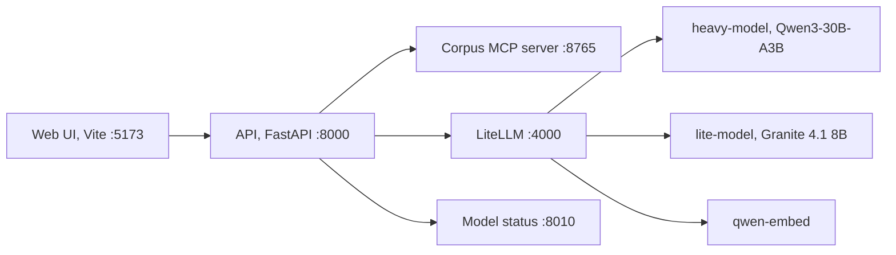
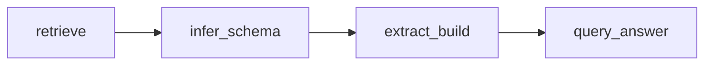
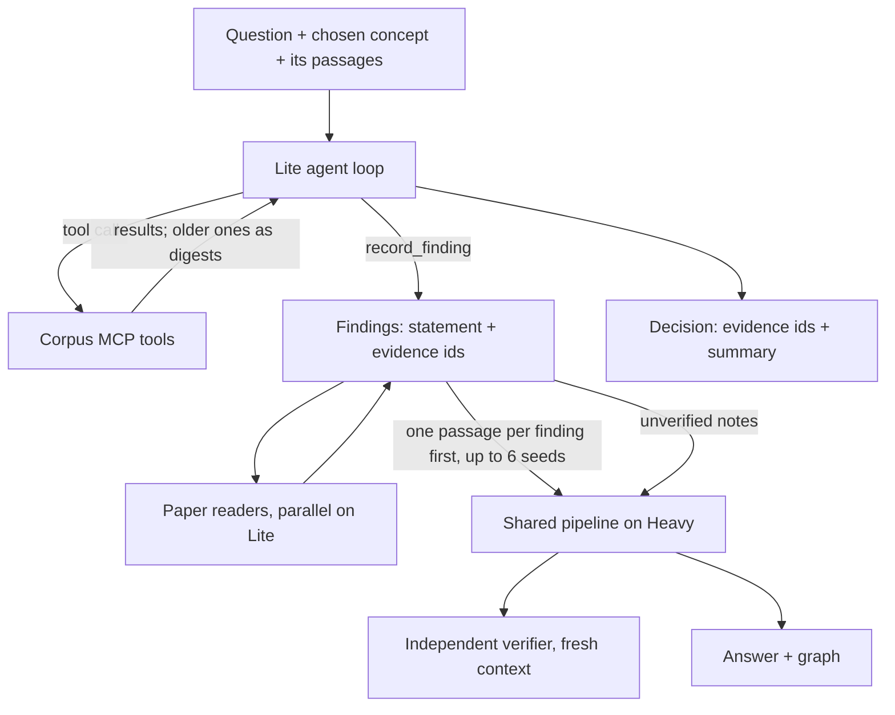

# Architecture

How a question becomes an answer, which model does what, and where each step lives. Vocabulary is defined in `CONTEXT.md`; decisions in `docs/adr/`.

## Services

LiteLLM, the models and the status API come from thesis-llm-setup. The API never calls raw vLLM ports.

## One run

Every path first turns the question into a typed plan (`planner.py`). Metadata and citation operations (authors, years, citing papers, author rankings) are answered from verified DBLP facts without full-text research; everything else is research.

| Path | Request `path` | What it does |
|---|---|---|
| Fast | `baseline` | Lexical retrieval (or hybrid, see below), schema inference, extraction, answer. |
| Adaptive | `baseline-enhanced` | Fast plus phrase expansion, a passage cap (`HARNESS_ADAPTIVE_MAX_PASSAGES`), evidence review and answer verification by the judge model. |
| Agentic | `agentic` | Passages are retrieved and the agent proposes concept readings grounded in them; the user picks one; the agent researches with MCP tools and records findings; paper readers add findings in parallel; the findings and their evidence seed the Adaptive pipeline; an independent verifier checks the cited evidence. |

The research pipeline (`harness_baseline.pipeline.Baseline20`) is a fixed LangGraph workflow:

- `retrieve` (`retrieval.py`): queries from the question and the chosen concept, BM25 ranking (`HARNESS_RETRIEVAL_MODE=hybrid`: BM25 and dense embeddings fused with reciprocal rank fusion, optionally reranked), agent seed passages kept, the chosen reading's supporting passages added as candidates (ranked like the others; only from the papers the question names, if it names any), passage cap.
- `infer_schema` (`research_steps.py`): the subschema for the question (seed DBLP terms plus invented `hrn:` terms).
- `extract_build`: EDC-style open extraction in batches of 2 passages, relation definition and mapping onto the subschema, evidence review (Adaptive/Agentic), claim subgraphs, graph validation.
- `query_answer`: SPARQL over the run graph, answer composition, answer verification (Adaptive/Agentic).
- `outcomes.py` turns the final state into a `Run` and its artifacts; `facts.py` answers fact operations.

The agentic run (`harness_agent.research.AgenticResearch`) is a sequence of named steps: heavy-load check, MCP research, findings, paper readers, seed selection, shared pipeline, decision review, assembly.

## Model roles

| Setting | Default alias | Used for |
|---|---|---|
| `HARNESS_MODEL_AGENT` | `lite-model` | Agent tool loop (MCP), context summaries, paper readers |
| `HARNESS_MODEL_EDC` | `lite-model` | Open extraction, relation definition and mapping |
| `HARNESS_MODEL_SMALL` | `heavy-model` | Planning, answer composition; schema inference, evidence review and verification in Fast/Adaptive |
| `HARNESS_MODEL_HIGH` | `heavy-model` | Concept proposal and schema inference in agentic runs |
| `HARNESS_MODEL_JUDGE` | `heavy-model` | Evidence review, answer verification, claim enrichment and the independent verifier in agentic runs |

Both chat models are served with a 32k context. Heavy's KV cache is the bottleneck (see thesis-llm-setup `docs/MODEL_PROFILES.md`).

## Schema and answer graph (Phase 4)

Schema inference (`engine.infer_schema`) reuses seed terms first. Every term it adds is OWL 2:
an invented property is an `owl:ObjectProperty` (class range) or `owl:DatatypeProperty` (literal
range) and a sub-property of the parent the model names from `parent_properties` when that parent
has the same kind, else of `hrn:researchRelation` / `hrn:researchAttribute`. An invented class is
a subclass of an existing class (default `hrn:ResearchEntity`); `HARNESS_SCHEMA_NEW_CLASSES=off`
maps new classes to `hrn:ResearchEntity`. The DBLP seed gets OWL 2 declarations in the merged graph
(the seed file only says `rdf:Property`). Each reading lists its terms with their origin (DBLP / core
/ invented) in `schemaTerms`, and `subschema.ttl` holds only those terms and their parents.

For research answers (not verified-fact answers), `backbone.py` adds the DBLP backbone of the
answer's papers to the answer graph: authors, venue as one shared node per venue, and citations among
them (`HARNESS_DBLP_BACKBONE`). The backbone is not part of `Reading.triples`, which gold scoring
reads. Every fact edge carries its origin, and the UI colours edges by origin. `triples.ttl` holds the
extracted triples plus the DBLP facts of the answer's papers only; the venue there stays DBLP's venue
string (`dblp:publishedIn`), because the corpus has no stream IRIs. `make graph-shape` measures the
result per run.

## Retrieval

`harness_corpus.store.CorpusStore.hybrid_rank` is the one ranked search (pipeline, concept evidence,
`search_evidence`, paper readers). BM25 always runs. With `HARNESS_RETRIEVAL_MODE=hybrid` and a current
dense index (`make embed`, written to `<corpus>/index/dense/`, ignored when `passages.jsonl` changed), the
question is also embedded with Qwen3-Embedding's query instruction and the two rankings are fused with
reciprocal rank fusion (k = 60, Cormack et al. 2009). So one setting switches every ranked search between
BM25 alone (`lexical`, the default) and BM25 + dense, which keeps the gold comparison clean. If
`HARNESS_MODEL_RERANK` names a served reranker, the fused top is reordered through LiteLLM `/rerank`.
Without the index, or when the embedding call fails (then for 60 s), the ranking is BM25 alone. The MCP tool roles are separate: `search_evidence` is the ranked search,
`search` is the exact boolean DSL (implicit AND), `grep` is a regular expression over passages.

Concept proposal (`concepts.py`, `HARNESS_CONCEPT_GROUNDING=retrieve_first`) retrieves the top passages and
keyphrases first and proposes readings from them; each reading cites the passages it rests on. A reading
whose terms match none of its 50 top-ranked passages is hidden (`HARNESS_HIDE_UNGROUNDED_READINGS`), unless
no reading has support, so fewer than three readings can be shown; hidden readings are recorded in the
proposal's `disagreement.json`. `legacy` restores the old order and shows every reading.

## Context flow in an agentic run

What the agent sees each turn: the system prompt with loaded skills, the question, the grounded context
(the chosen concept and its evidence passages), a curated set of about 14 non-overlapping tools
(`HARNESS_AGENT_TOOLSET`), the local `record_finding` tool, and the exchanges so far.

- Tool results older than the last `HARNESS_AGENT_KEEP_RESULTS` (3) exchanges are shown as short digests
  (observation masking).
- At 80% of the window (`HARNESS_AGENT_CONTEXT_TOKENS` minus the reply budget), the oldest exchanges are
  replaced by one summary written by the agent model (prompt `agent/compaction_summary`). The ledger note
  with digests and evidence ids is the fallback (`context.py`, `research_state.py`).
- Token estimates are calibrated from the `usage.prompt_tokens` the server reports.
- After `HARNESS_AGENT_MAX_TOOL_CALLS` (12) corpus calls, only `record_finding` is offered and the agent
  must decide.

The findings (`HARNESS_AGENT_HANDOFF=findings`) carry a statement and the evidence ids that support it;
ids the session never observed are rejected. Paper readers (`readers.py`, `HARNESS_SUBAGENT_READERS`)
then read the papers with the most evidence in parallel threads, one structured call each, and add up to
four findings per paper. Seeds take one passage per supervisor finding first, then the supervisor's
decision ids, then one passage per paper from the readers (cap `HARNESS_AGENTIC_MAX_MCP_SEEDS`, 12). The
finding statements also reach schema inference and answer composition as a separate `research_notes`
field (no ids, so the answer cannot cite a passage no triple uses; the answer verifier does not see
them). Extraction and review still work only from passages, so a finding becomes a triple only if the
passage supports it. If the answer verifier removes every claim of an answer written with the notes, the
answer is written once more from the triples alone (a `warn` check says so); if that also fails the run
ends `answer_unsupported`.

Extraction batches (EDC, 2 passages each) and evidence-review batches (24 candidates each) are sent to
the model `HARNESS_EXTRACTION_CONCURRENCY` (3) at a time; results keep batch order. Agentic runs read up
to `HARNESS_AGENTIC_MAX_PASSAGES` (24) passages. When a question names two papers, each gets an even
share of half that budget before seeds and ranking fill the rest. The answer's SPARQL (`query.rq`) is
built from the predicates of the cited triples, not written by the model.

Phase 5: the agentic path plans the chosen reading first; a fact lookup (authors, venues, counts, citations) is answered from verified facts without starting the MCP agent. The answer verifier returns a verdict per sentence; the answer is the accepted sentences. When nothing passes, the answer is written once more from the triples alone (told what was rejected); when that fails too, the answer states the extracted facts with a warn check instead of failing the run. An unstructured final agent decision no longer degrades a run that recorded validated findings.

## Prompts and settings

Every model call renders a named template from `harness_prompts` (`docs/PROMPTS.md`); the run records the versions in `Run.prompt_hashes`. Every setting is a field of `harness_config.Settings`, documented in `.env.example`.

## Artifacts

Each run writes a folder under `ARTIFACT_ROOT/<run id>/`: `run.json` (the full record), `trace.json`, `tool_calls.jsonl`, `verification.json`, `claims.json`, `readings.json`, `plans.json`, `retrieval.json`, `ledger.json`, `subschema.ttl`, `triples.ttl`, `answer.md` and more. `docs/RUN_ANALYSIS.md` explains how to read them.
