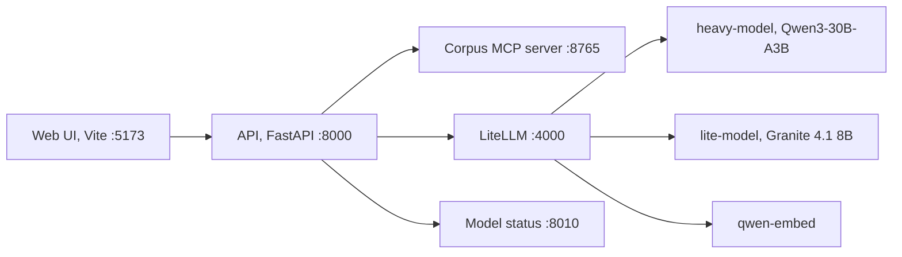
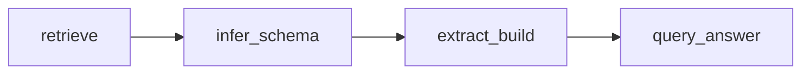
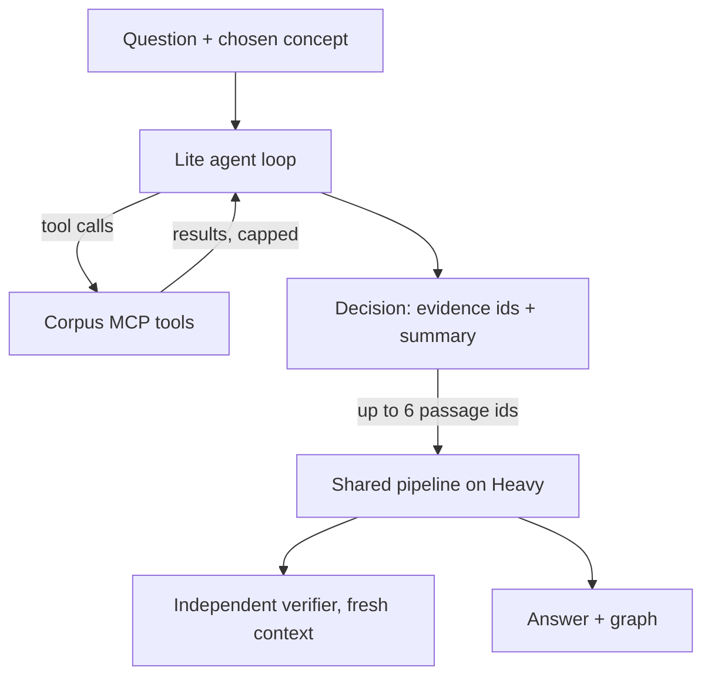

# Architecture

How a question becomes an answer, which model does what, and where each step lives. Vocabulary is defined in `CONTEXT.md`; decisions in `docs/adr/`.

## Services

LiteLLM, the models and the status API come from thesis-llm-setup. The API never calls raw vLLM ports.

## One run

Every path first turns the question into a typed plan (`planner.py`). Metadata and citation operations (authors, years, citing papers, author rankings) are answered from verified DBLP facts without full-text research; everything else is research.

| Path | Request `path` | What it does |
|---|---|---|
| Fast | `baseline` | Lexical/BM25 retrieval, schema inference, extraction, answer. |
| Adaptive | `baseline-enhanced` | Fast plus phrase expansion, a passage cap (`HARNESS_ADAPTIVE_MAX_PASSAGES`), evidence review and answer verification by the judge model. |
| Agentic | `agentic` | The agent proposes concept readings; the user picks one; the agent researches with MCP tools; its evidence seeds the Adaptive pipeline; an independent verifier checks the cited evidence. |

The research pipeline (`harness_baseline.pipeline.Baseline20`) is a fixed LangGraph workflow:

- `retrieve` (`retrieval.py`): queries from the question and the chosen concept, BM25 ranking, agent seed passages first, passage cap.
- `infer_schema` (`research_steps.py`): the subschema for the question (seed DBLP terms plus invented `hrn:` terms).
- `extract_build`: EDC-style open extraction in batches of 2 passages, relation definition and mapping onto the subschema, evidence review (Adaptive/Agentic), claim subgraphs, graph validation.
- `query_answer`: SPARQL over the run graph, answer composition, answer verification (Adaptive/Agentic).
- `outcomes.py` turns the final state into a `Run` and its artifacts; `facts.py` answers fact operations.

The agentic run (`harness_agent.research.AgenticResearch`) is a sequence of named steps: heavy-load check, MCP research, seed selection, shared pipeline, decision review, assembly.

## Model roles

| Setting | Default alias | Used for |
|---|---|---|
| `HARNESS_MODEL_AGENT` | `lite-model` | Agent tool loop (MCP) |
| `HARNESS_MODEL_EDC` | `lite-model` | Open extraction, relation definition and mapping |
| `HARNESS_MODEL_SMALL` | `heavy-model` | Planning, answer composition; schema inference, evidence review and verification in Fast/Adaptive |
| `HARNESS_MODEL_HIGH` | `heavy-model` | Concept proposal and schema inference in agentic runs |
| `HARNESS_MODEL_JUDGE` | `heavy-model` | Evidence review, answer verification, claim enrichment and the independent verifier in agentic runs |

Both chat models are served with a 32k context. Heavy's KV cache is the bottleneck (see thesis-llm-setup `docs/MODEL_PROFILES.md`).

## Context flow in an agentic run

What the agent sees each turn: system prompt with loaded skills, the question, the grounded context (the chosen concept), all tool schemas (specialist tools dropped first when space runs short), and the exchanges so far. When the conversation outgrows the window (`HARNESS_AGENT_CONTEXT_TOKENS` minus the reply budget, with a 10% margin), the oldest exchanges are replaced by a ledger note with digests and evidence ids (`context.py`, `research_state.py`). Only the agent's evidence ids reach the pipeline; its findings do not (see `docs/KNOWN_ISSUES.md`).

## Prompts and settings

Every model call renders a named template from `harness_prompts` (`docs/PROMPTS.md`); the run records the versions in `Run.prompt_hashes`. Every setting is a field of `harness_config.Settings`, documented in `.env.example`.

## Artifacts

Each run writes a folder under `ARTIFACT_ROOT/<run id>/`: `run.json` (the full record), `trace.json`, `tool_calls.jsonl`, `verification.json`, `claims.json`, `readings.json`, `plans.json`, `retrieval.json`, `ledger.json`, `subschema.ttl`, `triples.ttl`, `answer.md` and more. `docs/RUN_ANALYSIS.md` explains how to read them.
